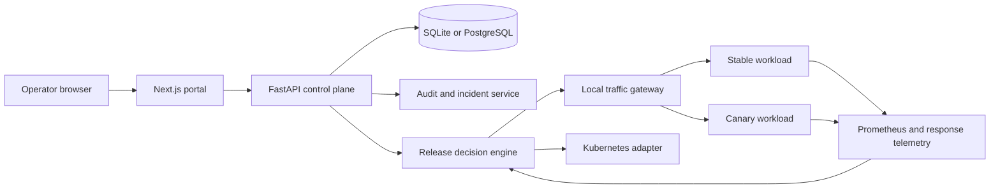
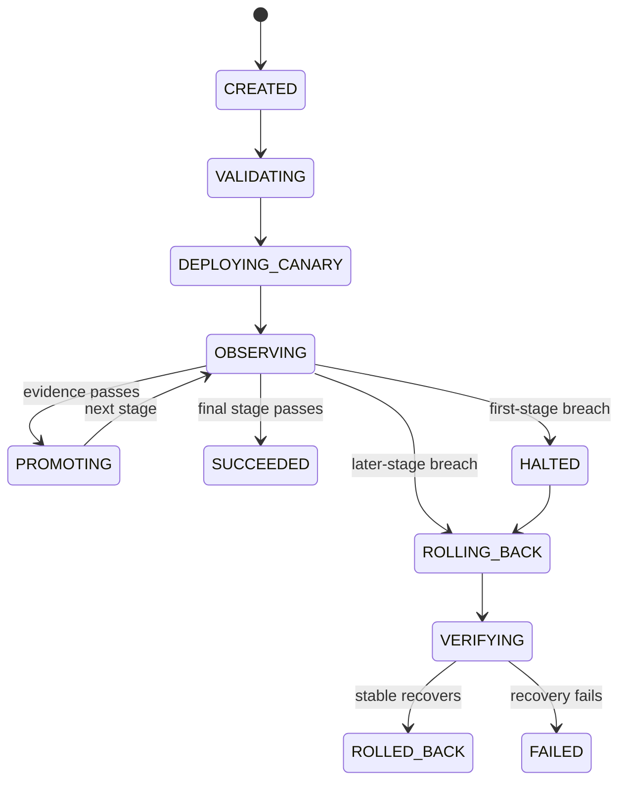

<div align="center">


<br />

[](https://www.python.org/)
[](https://fastapi.tiangolo.com/)
[](https://nextjs.org/)
[](https://prometheus.io/)
[](LICENSE)

### Release safely. Detect failure. Recover with evidence.

[See it in action](#see-rook-in-action) · [Architecture](#architecture) · [Quick start](#quick-start) · [API](#api-reference)

</div>

Rook is a local-first release and reliability control plane for Kubernetes workloads. It makes progressive delivery decisions from real request samples, readiness, latency distributions, error rates, restarts, resource pressure, and telemetry freshness. When a canary breaches policy, Rook stops promotion, restores the previous healthy version, verifies recovery, and records the evidence.

## Contents

- [See Rook in Action](#see-rook-in-action)
- [Overview](#overview)
- [Features](#features)
- [Architecture](#architecture)
- [Quick start](#quick-start)
- [API reference](#api-reference)
- [Testing](#testing)
- [Security](#security)
- [Troubleshooting](#troubleshooting)
- [Project structure](#project-structure)
- [Creator](#creator)

## See Rook in Action

The local workflow is implemented and can be replayed without a cloud account:

1. Start the FastAPI control plane and the Next.js portal.
2. Select the seeded `checkout-api` workload.
3. Start a canary release of `v2`.
4. Observe real requests through the local traffic gateway at 10, 25, 50, and 100 percent traffic.
5. Run the `elevated_errors` experiment against the disposable workload.
6. Watch the release halt, roll back to the last healthy version, and verify recovery.
7. Inspect the incident timeline and structured audit events.

The reproducible evidence command is:

```powershell
python scripts/run_local_demo.py
```

It writes the collected release, observation, incident, and recovery data to [`experiments/latest-run.json`](experiments/latest-run.json).

## Overview

Rook has five connected responsibilities:

| Responsibility | What Rook does | Evidence stored |
|---|---|---|
| Release orchestration | Runs a canary state machine across configured traffic stages | Release and rollout step rows |
| Health evaluation | Calculates p95 from latency samples and evaluates readiness, errors, restarts, and pressure | Observed values and decision reason |
| Telemetry | Collects genuine response status and latency from the local gateway, with Prometheus metrics when available | Sample count and timestamps |
| Recovery | Halts promotion, routes traffic to the previous version, then verifies stable health | Incident timeline and recovery status |
| Operations console | Presents workload, release, SLO, incident, audit, and settings views | API-backed UI state |

Rook is not a dashboard over invented metrics. It uses a deterministic local sample workload for demo and validation so the rollout flow is testable without a paid cloud account.

## Features

| Capability | Status |
|---|---|
| Canary rollout state machine | Implemented and verified in local mode |
| 10, 25, 50, and 100 percent traffic stages | Implemented and verified |
| Real local traffic routing | Implemented through an in-process FastAPI gateway |
| Error rate and latency distribution evaluation | Implemented and tested |
| Minimum sample and stale telemetry safeguards | Implemented and tested |
| Readiness, restart, and resource pressure signals | Implemented in the local adapter |
| Rollback and recovery verification | Implemented and verified |
| Incident timeline and audit history | Implemented and verified |
| Prometheus exposition | Implemented at `/metrics` |
| Docker and Kubernetes deployment assets | Included in the repository |
| Optional Kubernetes adapter and manifests | Included, not live-verified against a cluster in this environment |

## Architecture



### Rollout state machine



## Quick start

### 1. Install Python dependencies

```powershell
python -m pip install --upgrade pip
python -m pip install -e "backend[test]"
```

### 2. Install frontend dependencies

```powershell
Set-Location frontend
npm install
Set-Location ..
```

### 3. Start the API

```powershell
python -m uvicorn app.main:app --reload --host 127.0.0.1 --port 8000 --app-dir backend
```

### 4. Start the portal

```powershell
Set-Location frontend
npm run dev
```

Then open:

- http://127.0.0.1:3000
- http://127.0.0.1:8000/docs
- http://127.0.0.1:8000/api/v1/health

No login is required in the default local mode.

## API reference

Interactive OpenAPI documentation is served at `http://127.0.0.1:8000/docs`.

| Method | Endpoint | Purpose |
|---|---|---|
| GET | `/api/v1/health` | Control-plane and database health |
| GET | `/api/v1/overview` | Operational overview |
| GET | `/api/v1/workloads` | Workload inventory |
| GET | `/api/v1/workloads/{id}` | Workload state and pod snapshot |
| GET | `/api/v1/workloads/{id}/telemetry` | Stored rollout telemetry |
| GET | `/api/v1/releases` | Release history |
| POST | `/api/v1/releases` | Create a release record |
| POST | `/api/v1/releases/{id}/run` | Execute the release |
| GET | `/api/v1/incidents` | Incident history |
| GET | `/api/v1/audit` | Structured audit events |
| GET | `/api/v1/slo-policies` | SLO policy values |
| GET | `/api/v1/experiments` | Reliability lab runs |
| POST | `/api/v1/experiments` | Start a controlled experiment |
| GET | `/api/v1/settings` | Active local configuration |
| WS | `/api/v1/ws/releases/{id}` | Release state polling stream |

Create and run a release:

```powershell
$workload = Invoke-RestMethod http://127.0.0.1:8000/api/v1/workloads | Select-Object -First 1
$release = Invoke-RestMethod -Method Post -Uri http://127.0.0.1:8000/api/v1/releases -ContentType application/json -Body (@{
  workload_id = $workload.id
  release_version = "v2"
  image_reference = "rook/sample-app:v2"
  strategy = "canary"
} | ConvertTo-Json)
Invoke-RestMethod -Method Post -Uri "http://127.0.0.1:8000/api/v1/releases/$($release.id)/run"
```

## Testing

Run the project tests from the repository root:

```powershell
python -m pytest -q
```

This is the validated baseline for the project as currently implemented.

## Security

- CORS is restricted to configured local portal origins.
- Security response headers include content type, frame, referrer, and permissions policies.
- Mutation routes are protected by role checks in local mode and can be extended for stricter auth.
- Kubernetes permissions and deployment manifests are kept scoped and least-privilege oriented.
- Kubeconfig credentials are not stored in the application domain model.
- Release and experiment payloads are validated with Pydantic boundaries.

## Troubleshooting

| Symptom | Check |
|---|---|
| Portal shows control plane unavailable | Confirm API health and restart the backend |
| Release remains insufficient evidence | Check sample count, telemetry availability, and observation timestamp |
| Release halts | Open the rollout step and read its persisted decision reason |
| Rollback is failed | Inspect the incident and audit timeline |
| Metrics are unavailable | Confirm the sample workload still responds on the local gateway |

## Project structure

```text
Rook/
├── backend/
│   ├── app/
│   ├── migrations/
│   ├── tests/
│   └── pyproject.toml
├── frontend/
├── deployment/
├── docs/
├── experiments/
├── sample-app/
├── scripts/
├── docker-compose.yml
├── pytest.ini
├── README.md
├── LICENSE
└── .gitignore
```

## Creator

**Built by YOGESH R MEHTA**

GitHub: https://github.com/Yog-esh06
LinkedIn: https://www.linkedin.com/in/yog-esh06/
