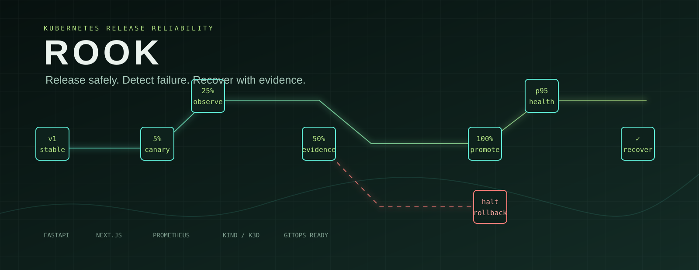
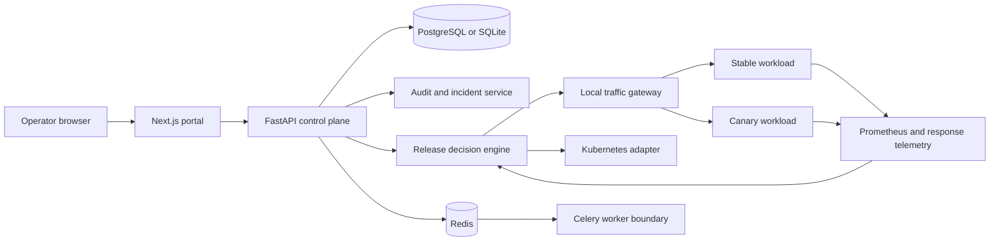
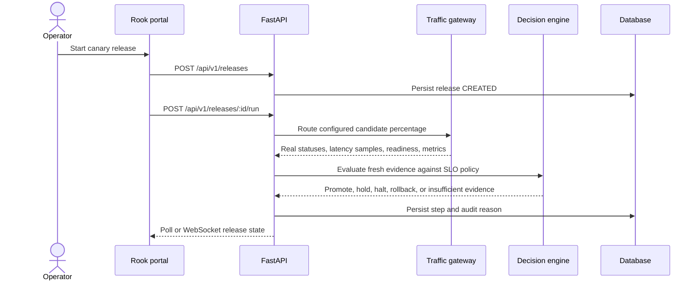
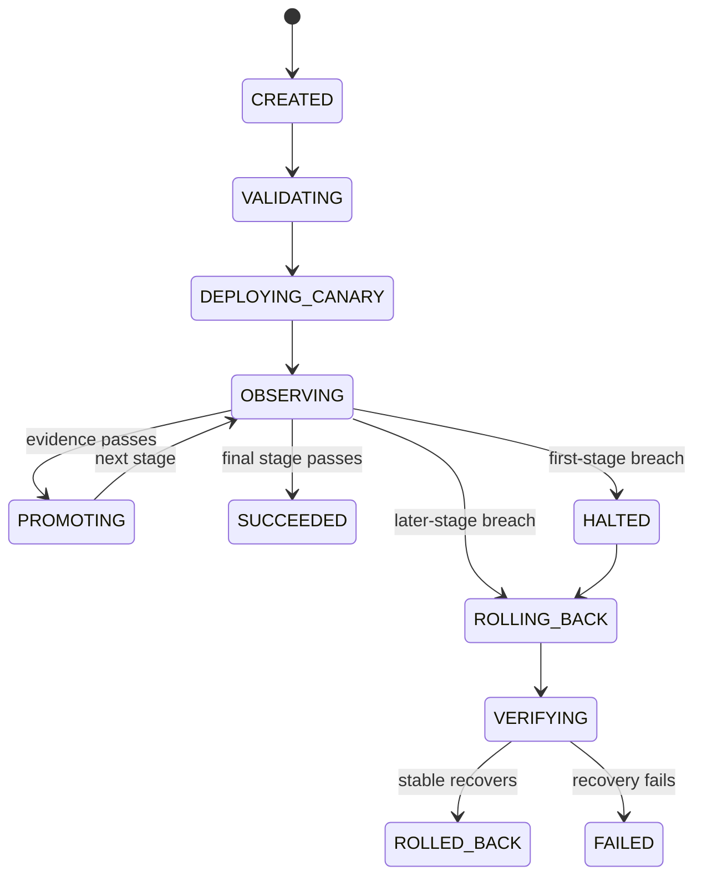
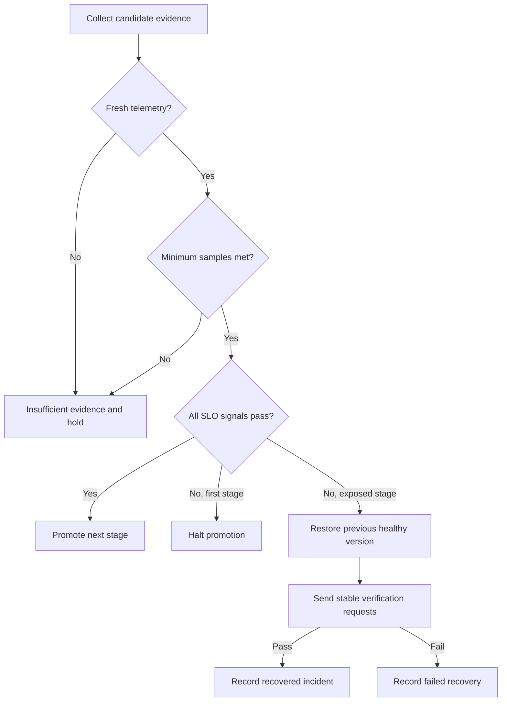

<div align="center">



<br />

[](https://www.python.org/)
[](https://fastapi.tiangolo.com/)
[](https://nextjs.org/)
[](https://prometheus.io/)
[](LICENSE)

### Release safely. Detect failure. Recover with evidence.

[See it in action](#see-rook-in-action) &nbsp; · &nbsp; [Architecture](#architecture) &nbsp; · &nbsp; [Quick start](#quick-start) &nbsp; · &nbsp; [API](#api-reference)

</div>

Rook is a local-first release and reliability control plane for Kubernetes workloads. It makes progressive delivery decisions from real request samples, readiness, latency distributions, error rates, restarts, resource pressure, and telemetry freshness. When a canary breaches policy, Rook stops promotion, restores the previous healthy version, verifies recovery, and records the evidence.

## Contents

- [See Rook in Action](#see-rook-in-action)
- [Overview](#overview)
- [Features](#features)
- [Architecture](#architecture)
- [Release lifecycle](#release-lifecycle)
- [Reliability experiments](#reliability-experiments)
- [Quick start](#quick-start)
- [Kubernetes setup](#kubernetes-setup)
- [API reference](#api-reference)
- [Testing](#testing)
- [Security](#security)
- [Troubleshooting](#troubleshooting)
- [Project structure](#project-structure)
- [Limitations](#limitations)
- [Roadmap](#roadmap)
- [Creator](#creator)

## See Rook in Action

The local workflow is implemented and can be replayed without a cloud account:

1. Start the FastAPI control plane and the Next.js portal.
2. Select the seeded `checkout-api` workload.
3. Start a canary release of `v2`.
4. Observe real requests through the local traffic gateway at 10%, 25%, 50%, and 100%.
5. Run the `elevated_errors` experiment against the disposable workload.
6. Watch the release halt, roll back to the last healthy version, and verify recovery.
7. Inspect the incident timeline and structured audit events.

The reproducible evidence command is:

```powershell
python scripts/run_local_demo.py
```

It writes the collected release, observation, incident, and recovery data to [`experiments/latest-run.json`](experiments/latest-run.json). The values in that file are produced by the running control plane. No benchmark values are copied into the repository.

### Recording status

The original banner is available at [`docs/media/banner.svg`](docs/media/banner.svg). The recording workflow is available at [`scripts/record_demo.mjs`](scripts/record_demo.mjs). GIF and video capture require Playwright, a browser binary, and FFmpeg. Those tools were not available in the inspected Windows environment, so no screenshot, GIF, or video is presented as recorded. Run the following after installing those dependencies:

```powershell
Set-Location frontend
npm install -D playwright
npx playwright install chromium
Set-Location ..
node scripts/record_demo.mjs
```

The script captures the final running UI and writes the available PNG and GIF outputs under `docs/media`. It does not generate placeholder media.

## Overview

Rook has five connected responsibilities:

| Responsibility | What Rook does | Evidence stored |
|---|---|---|
| Release orchestration | Runs a canary state machine across configured traffic stages | Release and rollout step rows |
| Health evaluation | Calculates p95 from latency samples and evaluates readiness, errors, restarts, and pressure | Observed values and decision reason |
| Telemetry | Collects genuine response status and latency from the local gateway, with Prometheus metrics when available | Sample count, timestamps, availability |
| Recovery | Halts promotion, routes traffic to the previous version, then verifies stable health | Incident timeline and recovery status |
| Operations console | Presents workload, release, SLO, incident, audit, and settings views | API-backed UI state |

Rook is not a dashboard over invented metrics. Kubernetes remains the source of truth in Kubernetes mode. Rook stores release decisions, policy, audit, and incident evidence in its own database.

## Features

| Capability | Status |
|---|---|
| Canary rollout state machine | Implemented and verified in local mode |
| 10%, 25%, 50%, and 100% traffic stages | Implemented and verified in local mode |
| Actual local traffic routing | Implemented through an in-process FastAPI gateway |
| Error rate and latency distribution evaluation | Implemented and verified with unit tests and real requests |
| Minimum sample and stale telemetry safeguards | Implemented and unit tested |
| Readiness, restart, and resource pressure signals | Implemented in local experiment adapter |
| Rollback and recovery verification | Implemented and verified in local mode |
| Incident timeline and audit history | Implemented and verified in local mode |
| Prometheus exposition | Implemented at `/metrics` |
| PostgreSQL, Redis, and Celery boundaries | Implemented in Compose configuration |
| Kubernetes adapter and least-privilege manifests | Implemented, not verified against a live cluster in this environment |
| Argo Rollouts integration | Planned |
| Recorded screenshots, GIFs, and video | Recording workflow provided, media not recorded in the inspected environment |

## Architecture



More detail is in [`docs/architecture/overview.md`](docs/architecture/overview.md) and [`docs/architecture/telemetry.md`](docs/architecture/telemetry.md).

### Release sequence



### Rollout state machine



### Failure detection and rollback



### Telemetry flow

```mermaid
flowchart LR
  Requests[Real HTTP requests] --> Gateway[Traffic gateway]
  Gateway --> Samples[Status and latency samples]
  Samples --> Percentile[p95 percentile]
  Workload[Ready endpoint and pod state] --> Signals[Readiness, restarts, pressure]
  Metrics[/metrics endpoint] --> Availability[Telemetry availability]
  Percentile --> Decision[Decision engine]
  Signals --> Decision
  Availability --> Decision
  Decision --> Evidence[(RolloutStep and AuditEvent)]
```

## Release lifecycle

The engine uses a strategy boundary so additional rollout strategies can be added without changing the API contract. The default local strategy uses a deterministic gateway with separate stable and candidate FastAPI applications. A candidate stage only promotes when telemetry is fresh, the minimum sample count is met, readiness is healthy, and every configured threshold passes.

The p95 value is calculated from the observed latency sample distribution. A single average is never used as a p95 substitute. Missing telemetry, stale timestamps, and small samples produce `INSUFFICIENT_EVIDENCE`.

The state machine is documented in [`docs/architecture/release-lifecycle.md`](docs/architecture/release-lifecycle.md).

## Reliability experiments

The Reliability Lab targets only the seeded disposable workload. Available experiments are:

- `elevated_errors`
- `delayed_responses`
- `readiness_failure`
- `crash_loop`
- `resource_pressure`
- `telemetry_unavailable`

Each run stores the experiment type, release ID, configuration, observed stages, decision reasons, incident ID, and recovery status. The local experiment runner is deterministic and does not inject failures into the host machine.

## Quick start

### Prerequisites

For the lightweight preview:

- Python 3.11 or newer
- Node.js 22 or newer
- npm

Docker Desktop is optional for the preview and required only for the Compose stack. Kubernetes tools are required only for Kubernetes mode.

### Windows PowerShell, local preview

```powershell
git clone <local-folder-or-repository-url> rook
Set-Location rook
Copy-Item .env.example .env
py -3.11 -m venv .venv
.\.venv\Scripts\Activate.ps1
python -m pip install -e "backend[test,quality]"
```

Start the API in one PowerShell window:

```powershell
$env:DATABASE_URL = "sqlite:///./rook.db"
$env:DEMO_MODE = "true"
python -m uvicorn app.main:app --app-dir backend --reload --host 127.0.0.1 --port 8000
```

Start the portal in a second window:

```powershell
Set-Location frontend
npm install --no-audit --no-fund
$env:NEXT_PUBLIC_API_URL = "http://127.0.0.1:8000"
npm run dev
```

Open:

| Service | URL |
|---|---|
| Portal | http://127.0.0.1:3000 |
| FastAPI Swagger | http://127.0.0.1:8000/docs |
| API health | http://127.0.0.1:8000/api/v1/health |
| Prometheus metrics | http://127.0.0.1:8000/metrics |

No login is required in local mode. The seeded workload is `checkout-api` in namespace `rook-demo`.

### First healthy release

Use the Release Center, choose `checkout-api`, leave the failure experiment as `normal`, and start `v2`. The release completes through 10%, 25%, 50%, and 100% when the API is healthy.

### Controlled failure and recovery

In Release Center choose `elevated HTTP 500 rate`, then start `v2` or use the Reliability Lab. Rook should stop at the first exposed stage, create an incident, restore the previous version, verify stable requests, and show `ROLLED_BACK` with `RECOVERED` incident status.

### Docker Compose

Compose starts PostgreSQL, Redis, FastAPI, a Celery worker boundary, the sample workload, and the Next.js portal:

```powershell
Copy-Item .env.example .env
docker compose up --build
```

The Compose path was configured but Docker was not installed in the inspected environment, so it remains unverified here. Stop with `Ctrl+C`, then remove containers and the demo database with `docker compose down -v`.

### Reset demo data

```powershell
python scripts/reset_demo.py
```

## Kubernetes setup

Kubernetes mode is optional. The manifests use namespace isolation, non-root containers, read-only filesystems, resource requests and limits, readiness and liveness probes, and a namespace-scoped service account.

```powershell
docker build -t rook/sample-app:v1 .\sample-app
kind create cluster --name rook
kind load docker-image rook/sample-app:v1 --name rook
kubectl apply -k deployment/kubernetes
kubectl -n rook-demo rollout status deployment/rook-sample-app
kubectl -n rook-demo get pods,svc,events
```

For Helm:

```powershell
helm lint deployment/helm/rook
helm template rook deployment/helm/rook --namespace rook-demo
helm upgrade --install rook deployment/helm/rook --namespace rook-demo --create-namespace
```

The Kubernetes adapter is available under `backend/app/kubernetes/adapter.py`. Install the optional client dependency with `python -m pip install -e "backend[kubernetes]"`. Kind, k3d, kubectl, and Helm were not installed in the inspected environment, so Kubernetes mode was not verified against a live cluster.

## API reference

Interactive OpenAPI documentation is served at `http://127.0.0.1:8000/docs`.

| Method | Endpoint | Permission | Purpose |
|---|---|---|---|
| GET | `/api/v1/health` | public | Control-plane and database health |
| GET | `/api/v1/overview` | viewer | Operational overview |
| GET | `/api/v1/applications` | viewer | Application catalog |
| GET | `/api/v1/workloads` | viewer | Workload inventory |
| GET | `/api/v1/workloads/{id}` | viewer | Workload state and pod snapshot |
| GET | `/api/v1/workloads/{id}/telemetry` | viewer | Stored rollout telemetry |
| GET | `/api/v1/releases` | viewer | Release history |
| POST | `/api/v1/releases` | operator | Create a release record |
| POST | `/api/v1/releases/{id}/run` | operator | Execute the release |
| GET | `/api/v1/incidents` | viewer | Incident history |
| GET | `/api/v1/audit` | viewer | Structured audit events |
| GET | `/api/v1/slo-policies` | viewer | SLO policy values |
| GET | `/api/v1/experiments` | viewer | Reliability lab runs |
| POST | `/api/v1/experiments` | operator | Start a controlled experiment |
| GET | `/api/v1/settings` | viewer | Active local configuration |
| WS | `/api/v1/ws/releases/{id}` | operator | Release state polling stream |

Create and run a release:

```powershell
$workload = Invoke-RestMethod http://127.0.0.1:8000/api/v1/workloads | Select-Object -First 1
$release = Invoke-RestMethod -Method Post -Uri http://127.0.0.1:8000/api/v1/releases -ContentType application/json -Body (@{
  workload_id = $workload.id
  release_version = "v2"
  image_reference = "rook/sample-app:v2"
  strategy = "canary"
} | ConvertTo-Json)
Invoke-RestMethod -Method Post -Uri "http://127.0.0.1:8000/api/v1/releases/$($release.id)/run"
```

When `AUTH_ENABLED=true`, browser-facing mutation routes require `X-Rook-Role: operator` or `admin`. Local mode disables the header gate for a frictionless preview. See [`docs/api.md`](docs/api.md) for error codes and request correlation.

## Testing

Checks run during this implementation:

```powershell
python -m pytest -q
python -m ruff check backend
Set-Location frontend
node node_modules/typescript/bin/tsc --noEmit
node node_modules/next/dist/bin/next build --webpack
```

The passing backend suite covers state transitions, p95 distribution calculation, minimum sample safeguards, stale telemetry, threshold decisions, API validation, real local request observations, rollback, recovery, and audit-visible behavior. The frontend typecheck and production webpack build passed.

Additional validation scripts are `python scripts/validate_kubernetes.py`, `python scripts/validate_helm.py`, and `python scripts/validate_readme.py`. Playwright end-to-end tests are planned in `tests/e2e`; they were not run because the browser test dependency was not installed.

## Security

- CORS is restricted to configured local portal origins.
- Security response headers include content type, frame, referrer, and permissions policies.
- Mutation routes have role dependencies for admin, operator, and viewer roles.
- Kubernetes permissions are namespace-scoped and do not expose unrestricted cluster administration.
- Kubeconfig credentials are never persisted in the domain model.
- Structured logs and audit metadata exclude secrets by design.
- Release and experiment payloads are validated with Pydantic boundaries.
- CI includes Bandit and Trivy steps. They require the project dependencies and Docker runtime respectively.

See [`docs/security.md`](docs/security.md) and [`docs/runbooks/kubernetes-api-unavailable.md`](docs/runbooks/kubernetes-api-unavailable.md).

## Troubleshooting

| Symptom | Check |
|---|---|
| Portal shows control plane unavailable | Confirm API health and set `NEXT_PUBLIC_API_URL=http://127.0.0.1:8000` before starting Next.js |
| Release remains insufficient evidence | Check sample count, telemetry availability, and observation timestamp |
| Release halts | Open the rollout step and read its persisted decision reason |
| Rollback is failed | Follow [`docs/runbooks/rollback-failure.md`](docs/runbooks/rollback-failure.md) |
| Metrics are unavailable | Follow [`docs/runbooks/telemetry-unavailable.md`](docs/runbooks/telemetry-unavailable.md) |
| Kubernetes calls fail | Follow [`docs/runbooks/kubernetes-api-unavailable.md`](docs/runbooks/kubernetes-api-unavailable.md) |
| Docker Compose does not start | Confirm Docker Desktop is running and ports 3000, 8000, and 8080 are free |

## Project structure

```text
rook/
├── backend/app/           control plane, domain, rollout, adapters, services
├── backend/migrations/    Alembic configuration and initial schema
├── frontend/              Next.js operations portal
├── sample-app/             real containerized workload
├── deployment/             Compose, Kubernetes, Helm, Prometheus, Grafana
├── experiments/            reproducible run evidence
├── scripts/                reset, demo, validation, and recording tools
├── docs/architecture/      system and lifecycle diagrams
├── docs/runbooks/          operational recovery guides
├── tests/e2e/              Playwright test location
└── .github/workflows/      CI, quality, security, and container checks
```

## Limitations

### Implemented and verified

- Local FastAPI control plane with SQLite persistence
- Seeded workload, SLO policy, release, rollout step, incident, experiment, and audit models
- Real request-driven local traffic gateway
- Healthy promotion and controlled failure recovery paths
- Next.js console with connected overview, applications, releases, workloads, reliability, SLO, incident, audit, and settings views
- Unit and API flow tests
- Production frontend build and TypeScript validation

### Implemented but not verified here

- PostgreSQL and Redis Compose services
- Celery worker boundary
- Kubernetes client adapter against a live cluster
- Kubernetes and Helm deployment manifests against a live cluster
- Trivy image scan and Docker build

### Planned

- Argo Rollouts adapter with native Kubernetes traffic routing
- External Prometheus range queries and stale data watermarking
- OIDC and production-grade session management
- Full Playwright release and recovery coverage
- Captured GIF, screenshots, and MP4 walkthrough after installing recording dependencies

## Roadmap

1. Add a native Argo Rollouts strategy implementation.
2. Add external Prometheus range queries and stale data watermarking.
3. Add OIDC and production-grade session management.
4. Add Playwright release and recovery coverage.
5. Record the verified browser workflow and publish optimized media.

## Creator

**Built by YOGESH R MEHTA**

GitHub: [https://github.com/Yog-esh06](https://github.com/Yog-esh06)

LinkedIn: [https://www.linkedin.com/in/yog-esh06/](https://www.linkedin.com/in/yog-esh06/)
# Rook

# Rook

