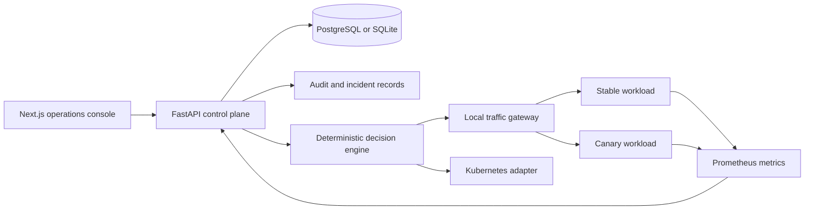

# Rook architecture

Rook separates the control plane from cluster state, telemetry, rollout evaluation, and the operator portal.

The default preview uses SQLite and an in-process gateway so it can run without a paid cloud account or a local cluster. The Kubernetes adapter is an explicit integration boundary. The cluster deployment manifests are provided for Kind, k3d, or an external cluster.
