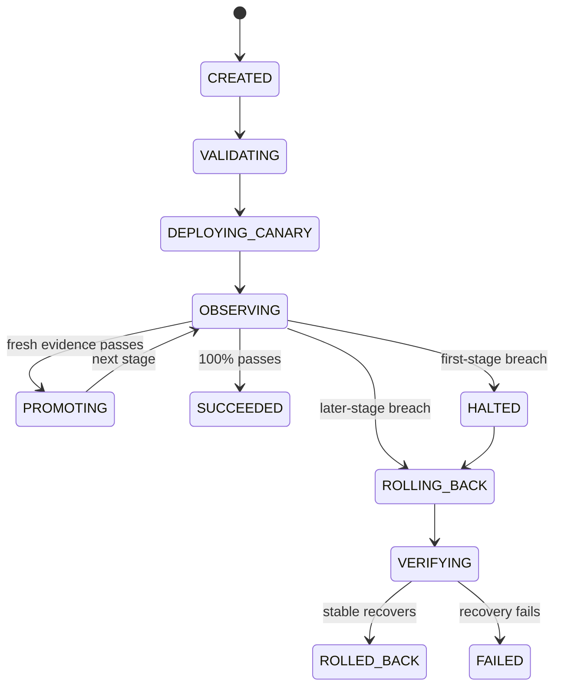

# Release lifecycle

Rook never treats missing, stale, or undersampled telemetry as a pass. The decision record includes the observed error rate, p95 latency, readiness, restart count, resource pressure, sample count, and reason.
