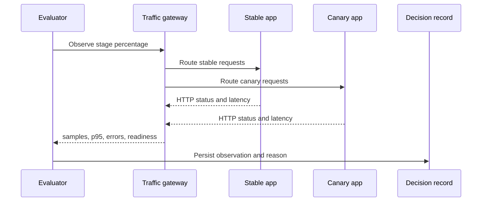

# Telemetry flow

The sample workload exposes `/metrics` in Prometheus text format. The local gateway collects request status and latency samples directly from real FastAPI responses. The control plane stores those observations on each rollout step and exposes them through `/api/v1/workloads/{id}/telemetry`.

